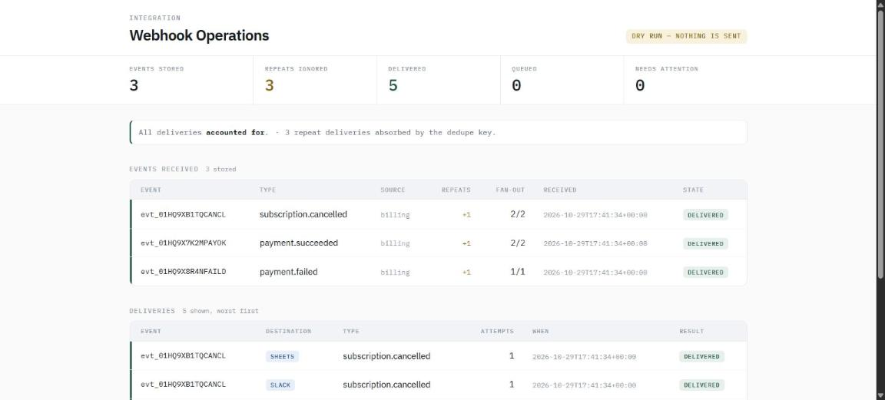

# Webhook Integration Service

Receives signed webhooks, stores them, and fans them out to Slack and Google
Sheets with deduplication, retries and a replay tool.



The problem this solves: every webhook provider retries, so your endpoint
*will* receive the same event more than once. Without a dedupe key that means
duplicate Slack messages, duplicate spreadsheet rows, and in the worst case
duplicate side effects. This service makes a repeat delivery a no-op — and
puts the count of absorbed repeats on the front page, because that number is
the product.

## Run it

```bash
python -m venv .venv && .venv/Scripts/activate   # Linux/macOS: source .venv/bin/activate
pip install -r requirements.txt

export WEBHOOK_SECRET=demo-secret                # Windows: $env:WEBHOOK_SECRET="demo-secret"
uvicorn app.main:app --reload
```

In a second terminal:

```bash
python replay.py --secret demo-secret --twice --drain
```

Then open http://127.0.0.1:8000 for the operations page.

Dry-run is on by default, so this works with no Slack or Sheets credentials —
deliveries are written to `dry_run.log` instead of being sent.

### Real output from that command

```
--- round 1 ---
payment_failed.json              HTTP 200  {"status": "accepted", "event_id": "evt_01HQ9X8R4NFAILD", "queued": ["slack"]}
payment_succeeded.json           HTTP 200  {"status": "accepted", "event_id": "evt_01HQ9X7K2MPAYOK", "queued": ["slack", "sheets"]}
subscription_cancelled.json      HTTP 200  {"status": "accepted", "event_id": "evt_01HQ9XB1TQCANCL", "queued": ["slack", "sheets"]}
unrouted_event.json              HTTP 200  {"status": "ignored", "type": "invoice.draft_created"}
--- round 2 ---
payment_failed.json              HTTP 200  {"status": "duplicate", "event_id": "evt_01HQ9X8R4NFAILD", "queued": []}
payment_succeeded.json           HTTP 200  {"status": "duplicate", "event_id": "evt_01HQ9X7K2MPAYOK", "queued": []}
subscription_cancelled.json      HTTP 200  {"status": "duplicate", "event_id": "evt_01HQ9XB1TQCANCL", "queued": []}
unrouted_event.json              HTTP 200  {"status": "ignored", "type": "invoice.draft_created"}
drain: {"delivered": 5, "retried": 0, "dead": 0}
```

Eight requests, five deliveries. The second round changed nothing.

## The operations page

`GET /` is the page you leave open when an integration matters. It answers the
three questions an owner actually has:

- **Is anything broken?** The "Needs attention" figure counts deliveries that
  gave up. Non-zero turns the banner red and tells you to requeue after fixing
  the cause.
- **Is anything stuck?** "Queued" counts deliveries waiting on their next
  backoff window.
- **Is the dedupe working?** "Repeats ignored" counts every repeat the unique
  key has absorbed, and each event row shows its own `+n`.

Below that: every event with its fan-out (`2/2` delivered), and every delivery
with its attempt count and last error, worst first.

## Tests

```bash
pytest -q
```

Thirteen tests covering acceptance, deduplication, repeat counting, bad,
missing and stale signatures, malformed JSON, unrouted event types, delivery,
the retry-then-dead path, requeue, and the operations page both with data and
empty.

## How it works

```
provider ──POST──> /webhooks/{source}
                      │  verify HMAC + timestamp      -> 401 if bad
                      │  INSERT OR IGNORE into events -> "duplicate" if seen
                      │  queue one delivery per route
                      └─ 200 immediately

worker.py (scheduled) ──> for each due delivery
                            success -> delivered
                            failure -> backoff, retry, eventually 'dead'
```

The receiver never calls a destination inside the request. A provider that
doesn't get a fast 200 starts retrying, and doing destination I/O in the
request handler is how you get a timeout *and* a duplicate.

## Signature scheme

```
X-Signature: t=<unix-ts>,v1=<hex hmac-sha256 of "{t}.{raw body}">
```

Same scheme Stripe uses. Verification is constant-time (`hmac.compare_digest`),
and signatures older than `WEBHOOK_TOLERANCE` seconds are rejected so a
captured request can't be replayed later.

## Endpoints

| Route | Purpose |
|---|---|
| `GET /` | Operations page |
| `POST /webhooks/{source}` | Receive an event |
| `POST /admin/drain` | Process the delivery queue now |
| `POST /admin/requeue?event_id=` | Revive dead deliveries after fixing the cause |
| `GET /events` | Recent events received |
| `GET /healthz` | Delivery counts; `degraded` when anything is dead |

## Configuration

| Variable | Default | Meaning |
|---|---|---|
| `WEBHOOK_SECRET` | `dev-secret-change-me` | Shared signing secret |
| `WEBHOOK_SYNC_DB` | `webhook_sync.db` | SQLite path |
| `WEBHOOK_TOLERANCE` | `300` | Max signature age, seconds |
| `WEBHOOK_MAX_ATTEMPTS` | `5` | Attempts before a delivery is parked |
| `WEBHOOK_BASE_BACKOFF` | `30` | First retry delay; doubles each attempt |
| `WEBHOOK_DRY_RUN` | `1` | `0` to actually send |
| `SLACK_WEBHOOK_URL` | — | Slack incoming webhook |
| `SHEETS_WEBHOOK_URL` | — | Endpoint that accepts `{"row": [...]}` |

Routing lives in `config.ROUTES`: event type to list of destinations.

## Scheduling the worker

```cron
* * * * *  cd /srv/webhook-sync && .venv/bin/python -m app.worker >> worker.log 2>&1
```

Exits non-zero when a delivery hits the attempt cap, so your scheduler can alert.

## Design notes

- **One unique column does the real work.** `events.event_id` is `UNIQUE`, so a
  repeat insert is a no-op and no second set of deliveries is queued.
- **Repeats are counted, not just discarded.** `duplicate_hits` is what the
  operations page reports; a protection you can't see is one nobody believes in.
- **Schema changes migrate in place.** `CREATE TABLE IF NOT EXISTS` leaves an
  older database without newer columns, so `init()` checks `PRAGMA table_info`
  and adds what's missing rather than asking anyone to drop data.
- **A 4xx from a destination still counts against the attempt budget.** It will
  never succeed, and the cap stops it spinning forever.
- **Unrouted event types get a 200.** Providers send plenty of types you never
  subscribed to; a 4xx just makes them retry.

## Layout

```
app/security.py            HMAC signing and verification
app/store.py               SQLite schema, idempotency, backoff bookkeeping
app/destinations.py        Slack and Sheets adapters, dry-run mode
app/worker.py              queue drain with retry
app/main.py                FastAPI receiver, operations page, admin endpoints
app/templates/operations.html  the page
replay.py                  send fixtures at a running instance
fixtures/                  four sample events, one deliberately unrouted
tests/                     pytest suite
```

## Verified

Run on 2026-10-29, Python 3.13.1: `pytest -q` → 13 passed. Live replay of four
fixtures twice → 3 accepted, 3 duplicates, 1 ignored (twice), 5 delivered, 0
dead, 3 repeats counted, no server errors. Operations page returned 200 with
that data.
